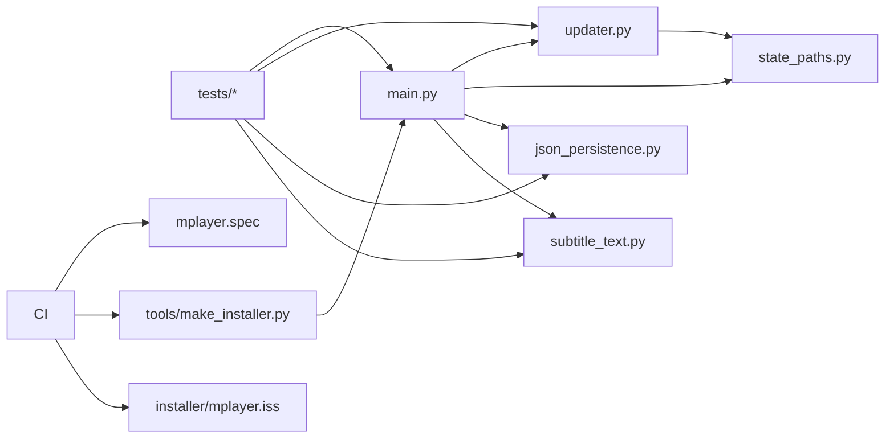

# Architecture map

## Module dependency graph

No runtime module imports `main`; no cycles. `state_paths`, `json_persistence`, and `subtitle_text` are shallow leaves that pass the deletion test because they have real importers.

## Authority map

| Concept | Authority | Notes |
|---|---|---|
| Product name/version | `main.py:189-190` | Spec, CI, installer, help, updater all derive from it. |
| State directory | `state_paths.py:7-13` | Env `MPLAYER_STATE_DIR` or `%LOCALAPPDATA%\mplayer`. |
| State file paths | `main.py:291-296` | Resume/session env overrides; legacy fallback for migration. |
| Atomic JSON writes | `json_persistence.py:12` | Dead duplicate removed from `main.py`. |
| Subtitle text | `subtitle_text.py` | SRT parsing, encoding detection, contrast color; re-exported from `main.py` for existing imports. |
| Update result marker | `updater.py:141-175` + embedded PowerShell | Schema `{ok,from,to,reason,time}`; 600 s freshness. |
| Release/checksum names | `updater.py:29-30,201-206`, `ci.yml:155-164` | `mplayer-windows-v<tag>.zip` + `.sha256`. |
| Installer settings | `installer/mplayer.iss` | Per-user, `PrivilegesRequired=lowest`, HKA, 9 extensions. |
| Help content | `main.py:671-755` | `SHORTCUTS`/`HELP_NOTES`/`HELP_CATEGORIES`; tests import them. |

## Mutable state ownership

- `main.py`: no module-level mutable state; all runtime state belongs to `PlayerWindow` instances (~50 fields). Test monkeypatches are limited to `LEGACY_STATE_DIR` and `atomic_write_json`.
- `updater.py`: module globals `_PENDING`, `_STATUS`, `_PENDING_VERSION`, `_LAST_TAG`, `_CURRENT_VERSION`, `_LAST_CHECK`, protected by one lock. `main` mutates them only through the public functions.
- Files: `resume.json`, `session.json`, `update_result.json`, `%TEMP%\mplayer_autoupdate.log`, `%TEMP%\mplayer_update_<pid>.ps1`, staging/backup directories beside the app.

## Duplicate/near-duplicate implementations

1. Metadata formatter family repeats defensive coercion shape (low gain).
2. Help prose hardcodes tuning constants (user-visible wording — needs product decision).
3. Round 1 removed: duplicated extension list, duplicate JSON writer, audio enumeration duplication, outline-width formula, dead `PRESERVE_FILES` and `take_pending`.
4. Round 3 removed: deferred-generation boilerplate, seek commit duplication, subtitle text logic embedded in Qt module.

## Norm deviations / hazards

- CI release guards in `p11_release` are literal substring checks; moving steps or changing secrets names can break tests or falsely pass.
- Round 2 removed: hardcoded version fixture, lexicographic installer selection, duplicated p0 helpers, p38 stage-order anomaly.
- Exact README prose is asserted by many tests; wording is effectively a hard contract until a product decision changes it.

## Deletion-test verdicts

- Keep `state_paths` and `json_persistence`: shallow but load-bearing; folding either into `main` would create an updater→main/PySide6 dependency.
- Reject splitting `PlayerWindow` into mixins: ~150 methods share mutable state and init order; complexity would move to callers.
- Reject moving `__version__` out of `main.py`: spec parses the literal assignment; churn exceeds benefit.
- Delete dead duplicate helpers rather than introducing wrappers.
